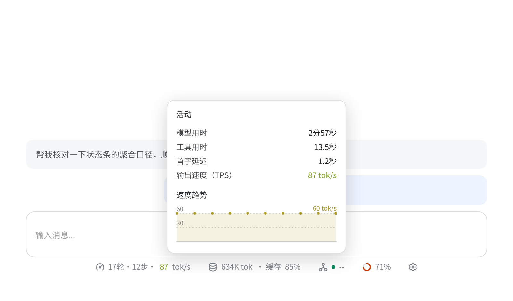
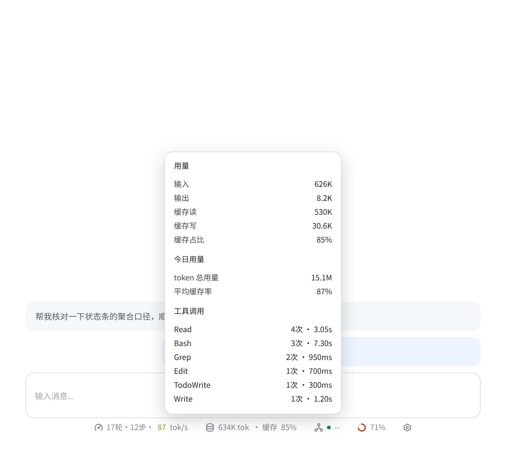
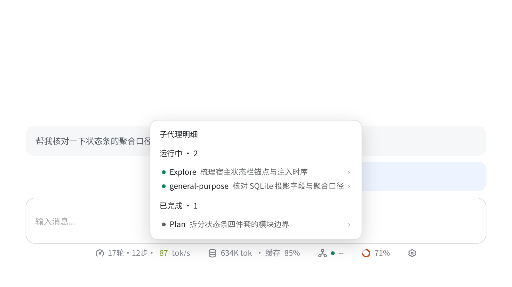
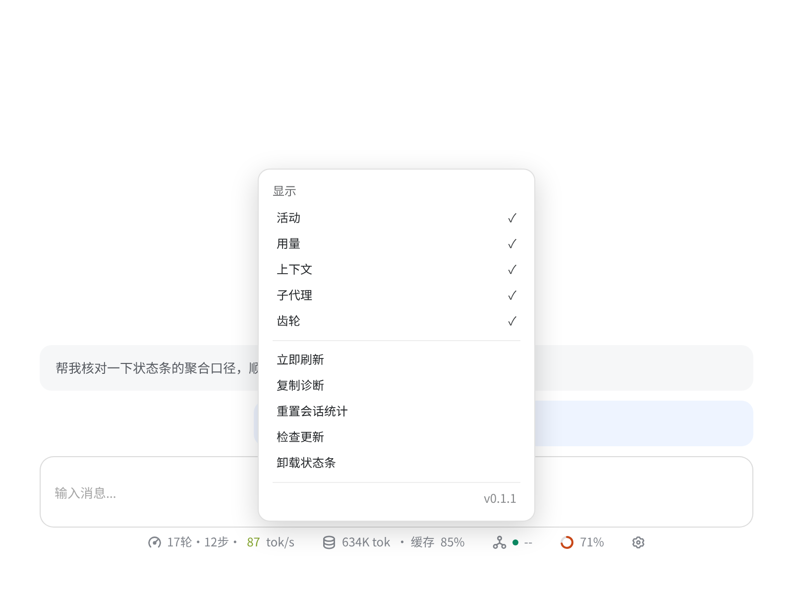
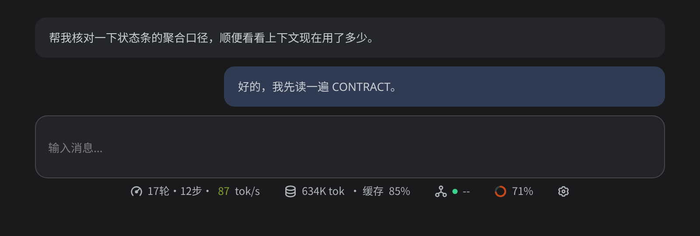

<div align="center">

# zcode-statusbar

**ZCode 输入框下方的一条状态栏：模型跑多快、这次会话烧了多少 token、上下文窗口还剩多少，一眼看完。**

第三方社区插件，不是 ZCode 官方功能。它通过修改 ZCode 的 `app.asar` 接入。

Windows / macOS / Linux · Python 3.8+ · [MIT](LICENSE)


上图由仓库里的 `scripts/render-statusbar.mjs` 加载真实的 `statusbar/statusbar.js` 渲染，数据为演示数据。

</div>

## 它解决什么问题

ZCode 默认只在生成结束后给出 token 总数。生成过程中模型多快、缓存命中多少、上下文是不是快满了，得自己翻面板，或者等账单。

这条状态条把四个读数放到输入框正下方，每秒刷新。

| 位置 | 显示 | 说明 |
|---|---|---|
| 活动 | `17轮·12步·87 tok/s` | 用户输入轮数、完成的工具调用数、当前速度 |
| 用量 | `634K tok · 缓存 85%` | 本会话累计 token、缓存读占输入的比例 |
| 子代理 | 绿点 · `53 tok/s` | 运行中显示实时速度，空闲时显示会话累计 token |
| 上下文 | 圆环 · `71%` | 占完整 context window 的比例，与官方面板同源 |
| 齿轮 | 菜单 | 开关各读数、刷新、重置、检查更新、卸载 |

速度数字的颜色跟着数值走：0 红、150 绿、300 蓝、500 以上封顶紫。

生成中的读数是**估算值**，数字带呼吸动画。生成结束后自动切回会话平均速度，标签同时改变。两种口径不混用。

## 截图

四个读数各自可以点开看明细。

**活动**：模型用时、工具用时、首字延迟、速度趋势曲线。



**用量**：输入、输出、缓存读写，本会话与今日两个口径，按工具名聚合的调用次数与耗时。



**上下文**：已用比例、分段占用条、系统提示词 / 工具定义 / 对话消息三项占比。


**子代理**：运行中与已完成分组，点进去看单个子代理的耗时、请求数与 token。



**齿轮**：显示开关、立即刷新、重置统计、检查更新、卸载。



深色主题沿用同一套结构，只换色值：



## 安装

### 前置条件

- ZCode 桌面客户端。
- Python 3.8 或更高版本。只用标准库，不需要 `pip install` 任何东西。

不需要 Node.js，状态栏跑在 ZCode 自带的 Node 环境里。

### 从源码安装

```sh
git clone https://github.com/longzhuzhu/zcode-statusbar.git
cd zcode-statusbar
python3 core/install.py
```

Windows 上把 `python3` 换成 `python`。

安装器把运行时复制到 `~/.zcode/zcode-statusbar/`，然后往 `app.asar` 的主入口追加一行注入。装完**完全退出 ZCode 再重新打开**，关掉窗口不算。

装完后的运行时目录可以自洽运行，克隆目录可以随意搬走或删除。

安装器会自动探测 ZCode 的位置。探测不到时指定一次，之后会记住：

```sh
python3 core/install.py --root /Applications/ZCode.app   # macOS
python3 core/install.py --root 'D:\Apps\ZCode'           # Windows
```

想先看它会动哪些文件，加 `--dry-run`，只打印不落盘。

Linux 上 ZCode 通常装在系统目录，`app.asar` 需要 `sudo` 才能写。安装器检测到权限不足时会打印具体命令。

### 更新

从源码安装的，`git pull` 后重跑一次 `core/install.py`。

齿轮菜单里的「检查更新」依赖插件市场的安装记录，它校验安装路径必须落在市场缓存目录、版本必须与记录一致。用 `git clone` 加安装器装的情况下没有这条记录，齿轮里的检查更新会失败。请用上面的方式更新。

ZCode 升级会覆盖 `app.asar`，状态条消失时重跑一次 `core/install.py` 即可。

## 这些数字是怎么算的

状态条读的是本地 SQLite 里的请求记录，不是账单，也不请求供应商接口。

| 读数 | 口径 |
|---|---|
| tok/s，生成中 | 按中英混排文字类型估算 token 增量，2 秒滑动窗。**估算值**，视觉上与核实值区分 |
| tok/s，完成后 | Σ输出 token ÷ Σ生成时长，只算主会话已完成的请求 |
| 缓存占比 | Σcache_read ÷ Σ输入。缓存已含在输入内，不重复相加 |
| 上下文占用 | 读宿主已有的隐藏锚点，与官方面板同一来源，分母是完整 context window |
| 轮次 | 按 `turnId` 去重。一轮里的多次工具循环只算一轮 |

生成时长优先取宿主相对耗时 `duration_ms`，普通输出扣除有效的 `time_to_first_token_ms`，避免把首字前等待摊进速度；思考请求保留思考阶段。指标缺失或异常时回退完整请求跨度。绝对时间 `first_token_at` 可能在写队列 flush 时才赋值，因此不用于缩窗；接近完成时的异常 TTFT 也不会用来缩窗。没有有效输出的请求不计入速度分母。

实时估算按中日韩文字约 1 字/token、ASCII 约 4 字/token、其余 Unicode 约 2 字/token 换算，可通过校准钩子覆盖系数。停止输出后样本不再刷新新鲜度，3 秒后回到会话均值。

完整字段与口径在 [statusbar/CONTRACT.md](statusbar/CONTRACT.md)。

## 它改了你的什么

这条需要说清楚，因为接入方式不是官方接口。

- **修改宿主程序文件**。安装器往 `app.asar` 的主入口追加一行动态 import，加载运行目录里的 loader。ZCode 没有状态栏插件接口，官方插件只能做 MCP 内联页或侧栏，位置和实时性都不满足。
- **不改官方 UI**。官方上下文按钮的 DOM、样式、弹层、交互保持原样，状态条自绘自己的圆环。
- **零会话干扰**。不在回答末尾加统计行，不在提交 prompt 时注入任何内容。
- **只读数据**。只读本地 SQLite 和 renderer 状态桥，不读账号凭据，不请求供应商接口。
- **联网只有一个出口**。Release 自动更新，校验渠道、版本、文件集与 SHA256。可以关。

宿主升级会覆盖 `app.asar`，状态条随之消失。用插件方式安装时，SessionStart hook 会在下次新建或恢复会话时自动修复注入。用 `git clone` 加安装器装的情况下没有这条 hook，升级后需要重跑一次 `core/install.py`。

## 卸载

```sh
python3 core/install.py --remove
```

卸载会反向还原引擎补丁、撤销已预注入的更新包、剥离 `app.asar` 里的注入行。

剥离失败时保留运行目录并打印修复指引，不会出现删了目录但注入行还在的情况。剥离成功后 `~/.zcode/zcode-statusbar/` 连同里面的配置一起删除。

也可以用齿轮菜单 → 卸载状态条，走同一个卸载入口，完成后自动重启 ZCode。齿轮路径不写豁免标记，下次会话仍会自动安装；要长期不装，用 `--remove`。

## 项目结构

```text
statusbar/         注入 renderer 的 UI 与数据层
  statusbar.js       状态条、弹层、菜单、主题
  turn-stats.js      生成中的速度采样
  session-stats.cjs  请求行聚合成会话快照
  ramp.js            速度与上下文两条色阶
core/              接入内核
  inject-main.cjs    loader：注入、数据泵、窗口路由
  install.py         安装入口
  uninstall.py       卸载编排
  patch_install.py   app.asar 注入与剥离
  plugin-updater.cjs Release 更新
zusage.py          只读 SQLite 查询与投影
plugins/zcode-statusbar/  扁平分发副本，由 core/sync_plugin.py 生成
tests/             Node 134 项、Python 192 项
docs/adr/          架构决策记录
```

`core/` 和 `statusbar/` 是源码正本。`plugins/zcode-statusbar/` 是生成物，改完源码跑 `python3 core/sync_plugin.py`，用 `--check` 查漂移。

## 开发

```sh
node --test tests/*.test.cjs                            # UI 与聚合逻辑
python3 -m unittest discover -s tests -p '*.py' -t .    # 内核、安装、卸载
python3 core/install.py --dev                           # 注入直指仓库，改文件即时生效
node scripts/render-statusbar.mjs                       # 重新生成 README 里的截图
```

`--dev` 模式不复制运行时，注入行指向克隆目录，改完 `statusbar/statusbar.js` 刷新窗口就能看到效果。切回标准安装，再跑一次不带 `--dev` 的。

截图脚本加载的是仓库里的真 `statusbar/statusbar.js`，数据经真 `statusbar/session-stats.cjs` 聚合。改了 UI 重跑一次，图跟着变。脚本会自己找本机的 Chrome 或 Chromium，找不到时用 `CHROME_PATH` 指定。

## 已知限制

- 接入方式依赖宿主 `app.asar` 的结构与 DOM 锚点。ZCode 大版本更新可能让注入失效或读数取不到。失效时状态条静默不渲染，不刷错误提示。
- 生成中的 tok/s 是字符估算，中英混排时误差明显。要准确值看完成后的会话均。
- 只在真实会话里显示。首页和新建任务（`data-session-id` 为 `draft`）不渲染。
- 窄窗口下按优先级逐档隐藏次要读数。缓存命中先让位，上下文圆环和齿轮任何档位都保留。

## 许可证

[MIT](LICENSE)
